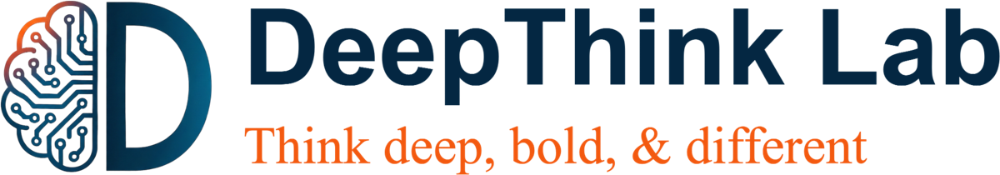

  <picture>
    <source media="(prefers-color-scheme: dark)" srcset="assets/logo-dark.png">
    
  </picture>

  Electrical and Computer Engineering · University of Michigan, Ann Arbor 
  PI: <a href="https://qingqu.engin.umich.edu/">Prof. Qing Qu</a>

  
  
  
  
  
  

## About

Our research lies at the intersection of signal processing, data science, machine learning, and numerical optimization. We are interested in computational methods for *learning low-complexity models from high-dimensional data*. Current directions:

- **Foundations of generative AI**
- **Deep representation learning**
- **Machine learning for scientific applications**

## Code

Code released with our publications. Click a paper title to open its repository; each one is forked here from the authors' original repository.

<b>2026</b>

| Paper | Venue | Links |
|---|---|---|
| [Breaking the Curse of Dimensionality: Diffusion Models Efficiently Learn Low-Dimensional Distributions](https://github.com/deepthink-umich/Diffusion-Model-Generalizability) | JMLR 2026 | [Paper](https://arxiv.org/abs/2409.02426) · [Project](https://www.huijiezh.com/diffusion-model-subspace-clustering/index.html) |
| [DCDP: Decoupled Data Consistency with Diffusion Purification for Image Restoration](https://github.com/deepthink-umich/Decoupled-Data-Consistency-with-Diffusion-Purification-for-Image-Restoration) | ICCP 2026 | [Paper](https://arxiv.org/abs/2403.06054) |
| [Generalization of Diffusion Models Arises with a Balanced Representation Space](https://github.com/deepthink-umich/diffusion-gen-from-rep) | ICLR'26 Oral at DeepMath'25 | [Paper](https://arxiv.org/abs/2512.20963) · [Project](https://la0ka1.github.io/diffusion-gen-from-rep/) |
| [AlphaFlow: Understanding and Improving MeanFlow Models](https://github.com/deepthink-umich/alphaflow) | ICLR'26 | [Paper](https://arxiv.org/abs/2510.20771) |

<b>2025</b>

| Paper | Venue | Links |
|---|---|---|
| [A Closer Look at Model Collapse: From a Generalization-to-Memorization Perspective](https://github.com/deepthink-umich/Model_Collapse) | NeurIPS'25 Spotlight (top 3.2%) | [Paper](https://arxiv.org/abs/2509.16499) · [Project](https://shilianghe007.github.io/model-collapse/index.html) |
| [Shallow Diffuse: Robust and Invisible Watermarking through Low-Dimensional Subspaces in Diffusion Models](https://github.com/deepthink-umich/Shallow-Diffuse) | NeurIPS'25 Spotlight (top 3.2%) | [Paper](https://arxiv.org/abs/2410.21088) · [Project](https://www.huijiezh.com/shallow-diffuse/) |
| [Understanding Deep Representation Learning via Layerwise Feature Compression and Discrimination](https://github.com/deepthink-umich/PNC_DLN) | JMLR 2025 | [Paper](https://arxiv.org/abs/2311.02960) |

<b>2024</b>

| Paper | Venue | Links |
|---|---|---|
| [BLAST: Block-Level Adaptive Structured Matrices for Efficient Deep Neural Network Inference](https://github.com/deepthink-umich/BLAST) | NeurIPS'24 | [Paper](https://arxiv.org/abs/2410.21262) |
| [Image Reconstruction Via Autoencoding Sequential Deep Image Prior](https://github.com/deepthink-umich/Aseq_DIP) | NeurIPS'24 | [Paper](https://openreview.net/forum?id=K1EG2ABzNE&noteId=KLbtyQ08BC) |
| [Exploring Low-Dimensional Subspaces in Diffusion Models for Controllable Image Editing](https://github.com/deepthink-umich/LOCO-Edit) | NeurIPS'24 | [Paper](https://arxiv.org/abs/2409.02374) · [Project](https://chicychen.github.io/LOCO/index.html) |
| [Compressible Dynamics in Deep Overparameterized Low-Rank Learning & Adaptation](https://github.com/deepthink-umich/deep-lora-transformers) | ICML'24 Oral (top 1.5%) | [Paper](https://arxiv.org/abs/2406.04112) |
| [Optimal Eye Surgeon: Finding Image Priors Through Sparse Generators at Initialization](https://github.com/deepthink-umich/Optimal-Eye-Surgeon) | ICML'24 | [Paper](https://arxiv.org/abs/2406.05288v1) |

<b>2023</b>

| Paper | Venue | Links |
|---|---|---|
| [Improving Efficiency of Diffusion Models via Multi-Stage Framework and Tailored Multi-Decoder Architectures](https://github.com/deepthink-umich/Multistage_Diffusion) | CVPR'24 | [Paper](https://arxiv.org/abs/2312.09181) · [Project](https://www.huijiezh.com/multistage-diffusion-model/) |
| [Efficient Low-Dimensional Compression of Overparameterized Models](https://github.com/deepthink-umich/comp-deep-nets) | AISTATS'24 | [Paper](https://proceedings.mlr.press/v238/min-kwon24a.html) |
| [Neural Collapse in Multi-label Learning with Pick-all-label Loss](https://github.com/deepthink-umich/NC_MLab) | ICML'24 | [Paper](https://arxiv.org/abs/2310.15903) |
| [The Law of Parsimony in Gradient Descent for Learning Deep Linear Networks](https://github.com/deepthink-umich/law-of-parsimony) | arXiv 2023 | [Paper](https://arxiv.org/abs/2306.01154) |

<b>2022</b>

| Paper | Venue | Links |
|---|---|---|
| [Neural Collapse with Normalized Features: A Geometric Analysis over the Riemannian Manifold](https://github.com/deepthink-umich/normalized-neural-collapse) | NeurIPS'22 | [Paper](https://openreview.net/forum?id=Zvh6lF5b26N) |
| [Are All Losses Created Equal: A Neural Collapse Perspective](https://github.com/deepthink-umich/nc_loss) | NeurIPS'22 | [Paper](https://openreview.net/forum?id=8rfYWE3nyXl) |
| [Hidden State Variability of Pretrained Language Models Can Guide Computation Reduction for Transfer Learning](https://github.com/deepthink-umich/variability-efficient-tuning) | Findings of EMNLP 2022 | [Paper](https://aclanthology.org/2022.findings-emnlp.422/) |
| [Robust Training under Label Noise by Over-parameterization](https://github.com/deepthink-umich/SOP) | ICML'22 | [Paper](https://proceedings.mlr.press/v162/liu22w.html) |
| [On the Optimization Landscape of Neural Collapse under MSE Loss: Global Optimality with Unconstrained Features](https://github.com/deepthink-umich/neural-collapse-MSE) | ICML'22 | [Paper](https://proceedings.mlr.press/v162/zhou22c.html) |

<b>2021</b>

| Paper | Venue | Links |
|---|---|---|
| [A Geometric Analysis of Neural Collapse with Unconstrained Features](https://github.com/deepthink-umich/Neural-Collapse) | NeurIPS'21 Spotlight (top 3%) | [Paper](https://proceedings.neurips.cc/paper/2021/hash/f92586a25bb3145facd64ab20fd554ff-Abstract.html) |
| [Convolutional Normalization: Improving Deep Convolutional Network Robustness and Training](https://github.com/deepthink-umich/ConvNorm) | NeurIPS'21 | [Paper](https://proceedings.neurips.cc/paper/2021/hash/f23d125da1e29e34c552f448610ff25f-Abstract.html) |
| [Weakly Convex Optimization over Stiefel Manifold Using Riemannian Subgradient-Type Methods](https://github.com/deepthink-umich/Riemannian-subgradient-methods) | SIAM J. Optim. 2021 | [Paper](https://epubs.siam.org/doi/abs/10.1137/20M1321000) |

<b>2020</b>

| Paper | Venue | Links |
|---|---|---|
| [Robust Recovery via Implicit Bias of Discrepant Learning Rates for Double Over-parameterization](https://github.com/deepthink-umich/robust-image-recovery) | NeurIPS'20 Spotlight (top 4%) | [Paper](https://proceedings.neurips.cc/paper/2020/hash/cd42c963390a9cd025d007dacfa99351-Abstract.html) |
| [Short and Sparse Deconvolution — A Geometric Approach](https://github.com/deepthink-umich/sparse_deconvolution) | ICLR'20 | [Paper](https://openreview.net/forum?id=Byg5ZANtvH) · [Project](https://deconvlab.github.io/) |

<b>2019 & Prior</b>

| Paper | Venue | Links |
|---|---|---|
| [Exact Recovery of Multichannel Sparse Blind Deconvolution via Gradient Descent](https://github.com/deepthink-umich/MCS-BD) | SIAM J. Imaging Sci. 2020 Spotlight (top 3%) | [Paper](https://epubs.siam.org/doi/abs/10.1137/19M1291327) |
| [Convolutional Phase Retrieval via Gradient Descent](https://github.com/deepthink-umich/convolutional_pr) | IEEE Trans. Inf. Theory 2020 | [Paper](https://ieeexplore.ieee.org/abstract/document/8888195) |
| [A Geometric Analysis of Phase Retrieval](https://github.com/deepthink-umich/pr_plain) | FoCM 2018 Frontiers of Science Award in Mathematics (ICBS'24) | [Paper](https://link.springer.com/article/10.1007/s10208-017-9365-9) |
| [Complete Dictionary Recovery over the Sphere I: Overview and the Geometric Picture](https://github.com/deepthink-umich/dl_focm) | IEEE Trans. Inf. Theory 2017 Best Student Paper Award (SPARS 2015) | [Paper](https://ieeexplore.ieee.org/document/7755794) |
| [Finding a Sparse Vector in a Subspace: Linear Sparsity Using Alternating Directions](https://github.com/deepthink-umich/psv) | IEEE Trans. Inf. Theory 2016 | [Paper](https://ieeexplore.ieee.org/document/7547961) |
| Abundance Estimation for Bilinear Mixture Models via Joint Sparse and Low-Rank Representation ([code, .zip](https://qingqu06.github.io/pdf/TGRS-demo-14.zip)) | IEEE TGRS 2014 | [Paper](https://ieeexplore.ieee.org/document/6619431) |

